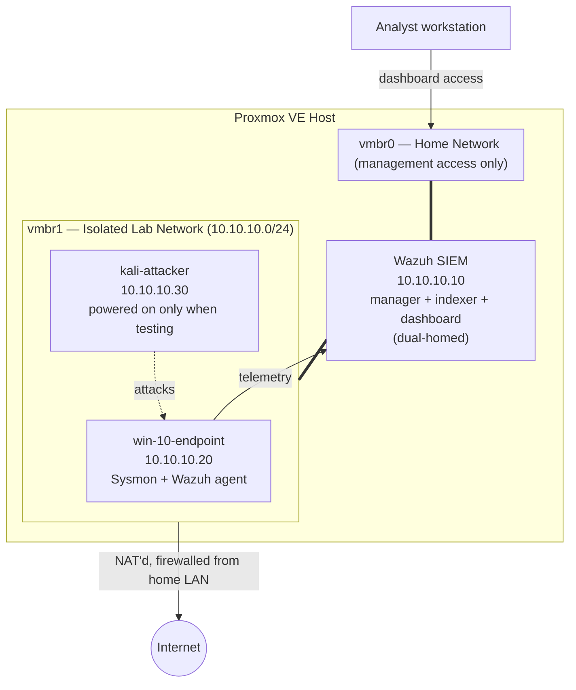

# Network Architecture

The lab runs on a single Proxmox VE host, split across two internal bridges so the attack/telemetry traffic never touches the home network.

## Notes

- **vmbr0 (home network)** carries management/dashboard access only — the analyst reaches the Wazuh dashboard over this bridge from the home LAN.
- **vmbr1 (isolated lab network, `10.10.10.0/24`)** is NAT'd to the internet (for updates/tooling) but firewalled off from the home LAN in both directions. All attacker and endpoint traffic stays on this bridge.
- **Wazuh is dual-homed**: one NIC on each bridge. This is the only host with a presence on both networks — it receives Sysmon/agent telemetry from `win-10-endpoint` over vmbr1, and serves the dashboard to the analyst over vmbr0.
- **`kali-attacker`** is powered on only when actively running a test, rather than left running continuously.

| Role | Hostname | IP | Bridge |
|---|---|---|---|
| SIEM / Manager | wazuh | 10.10.10.10 (lab) + home-side NIC | vmbr0 + vmbr1 |
| Target endpoint | win-10-endpoint | 10.10.10.20 | vmbr1 |
| Attack host | kali-attacker | 10.10.10.30 | vmbr1 |
