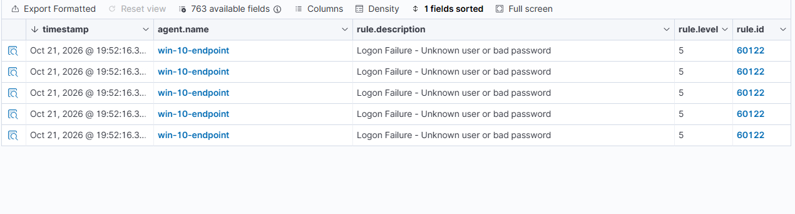
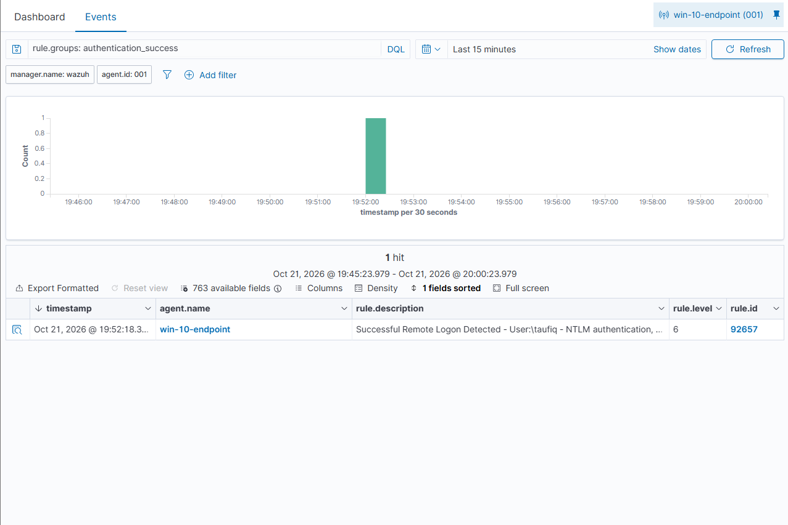
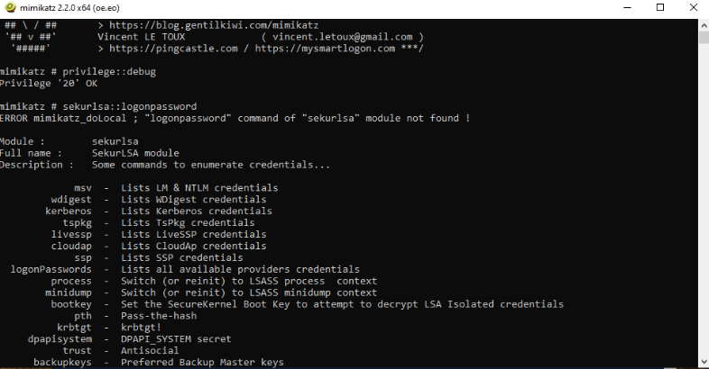
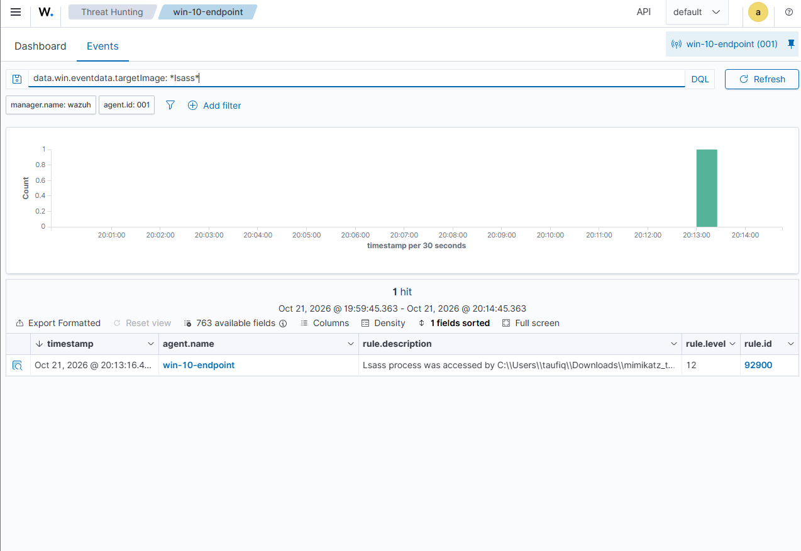

# Detection Validation Report: Baseline SOC Lab — Brute Force & Credential Dumping

**Analyst:** Taufiq
**Date:** 2026-10-21
**Environment:** Home SOC Lab (Proxmox, isolated network)
**Classification:** Internal / Portfolio

---

## 1. Objective

Validate that the deployed SIEM correctly detects two common post-exploitation techniques observed in real-world intrusions:

- **T1110 — Brute Force:** RDP credential guessing against a Windows endpoint
- **T1003.001 — OS Credential Dumping: LSASS Memory:** credential extraction from a compromised host

The goal was to confirm end-to-end detection — from raw telemetry generation, through log forwarding, to rule-based alerting — and to identify any gaps in default detection coverage.

---

## 2. Environment / Scope

**Architecture:** isolated lab network (`10.10.10.0/24`) hosted on Proxmox VE, NAT'd to the internet and firewalled from the home LAN. See `00-infrastructure/network-diagram.md` for the full topology.

| Role | Hostname | IP | Notes |
|---|---|---|---|
| SIEM / Manager | wazuh | 10.10.10.10 | Wazuh 4.14, all-in-one |
| Target endpoint | win-10-endpoint | 10.10.10.20 | Windows 10 Pro, Sysmon (Olaf Hartong "balanced" config), Wazuh agent 4.14.8 |
| Attack host | kali-attacker | 10.10.10.30 | Kali Linux 2026.2 |

**Tools used:** Wazuh 4.14 (manager + indexer + dashboard), Sysmon, Hydra, Mimikatz 2.2.0.

**Constraints:** standalone (non-domain-joined) Windows host, so credential material available to Mimikatz was limited to the local account.

---

## 3. Test 1 — RDP Brute Force (MITRE ATT&CK T1110)

### Procedure

1. Confirmed RDP reachability from the attack host:
   ```
   nmap -p 3389,445,139 10.10.10.20
   ```
   Result: port 3389 open (filtered prior to enabling Remote Desktop on the target), 445/139 filtered.

2. Ran a credential-guessing attack against RDP using a small wordlist containing several incorrect passwords followed by the valid one:
   ```
   hydra -l taufiq -P /tmp/small.txt -t 4 rdp://10.10.10.20
   ```

### Expected Outcome

Each failed authentication attempt should be logged by Windows and forwarded by the Wazuh agent; a successful authentication should generate a separate, distinguishable event.

### Evidence

- 5 consecutive authentication-failure events, agent `win-10-endpoint`, timestamp `2026-10-21 19:52:16`
- 1 authentication-success event, same agent, timestamp `2026-10-21 19:52:18` (two seconds after the failures)


*Figure 1: Five consecutive "Logon Failure" events (rule 60122) generated by Hydra's incorrect password attempts.*


*Figure 2: Successful NTLM logon (rule 92657) two seconds after the failures, once Hydra reached the valid password.*

### Result

| Event | Rule ID | Level | Description |
|---|---|---|---|
| Logon failure (x5) | 60122 | 5 | Logon Failure - Unknown user or bad password |
| Logon success (x1) | 92657 | 6 | Successful Remote Logon Detected - User:taufiq - NTLM authentication |

### Analysis

The full detection chain functioned correctly: RDP authentication attempts → Windows Security log → Wazuh agent → manager rule matching → dashboard alert. Both the failed and successful authentication events were individually detected and correctly attributed to the source IP (`10.10.10.30`) and target account (`taufiq`).

However, each event was evaluated independently. No rule correlated the pattern of **multiple failures immediately followed by a success from the same source** — the defining signature of a successful brute-force attack — into a single, higher-severity alert. On a live dashboard, a level-6 success event sitting seconds after five level-5 failures is easy to miss unless an analyst is specifically looking for the sequence.

---

## 4. Test 2 — Credential Dumping via Mimikatz (MITRE ATT&CK T1003.001)

### Procedure

1. Temporarily disabled Windows Defender real-time protection on the target (required to execute Mimikatz; reverted after testing).
2. Executed Mimikatz as Administrator on `win-10-endpoint`:
   ```
   privilege::debug
   sekurlsa::logonpasswords
   ```

### Expected Outcome

Sysmon Event ID 10 (ProcessAccess) should capture any process opening a handle to `lsass.exe`, regardless of the requesting process's name — this is a behavioral detection rather than a signature match.

### Evidence

- Mimikatz 2.2.0 executed on `win-10-endpoint`, `sekurlsa::logonpasswords` run after privilege escalation
- Sysmon Event ID 10 (ProcessAccess): handle opened to `lsass.exe`
- Wazuh alert, timestamp `2026-10-21 20:13:16`


*Figure 3: Mimikatz 2.2.0 running `privilege::debug` and `sekurlsa::logonpasswords` on `win-10-endpoint`.*


*Figure 4: Rule 92900 (level 12) firing on the LSASS memory access, identifying the source process by full file path rather than by name signature.*

### Result

| Event | Rule ID | Level | Description |
|---|---|---|---|
| LSASS process access | 92900 | 12 | Lsass process was accessed by C:\Users\taufiq\Downloads\mimikatz_t... |

### Analysis

This detection fired at level 12 — substantially higher severity than either brute-force event — reflecting the seriousness of direct LSASS memory access. Critically, the rule matched on **behavior** (a process requesting a handle to `lsass.exe`), not on the string "mimikatz" anywhere in the event. This means the same detection would fire even if the tool were renamed, which makes it materially more robust than a signature-based detection would be.

This is also a stronger result than it would have been on a domain-joined host: on a standalone machine, Mimikatz only had the local account's credential material available. On a domain-joined endpoint with a cached privileged account session, the same technique could expose credentials enabling lateral movement — a scenario planned for a future Active Directory lab.

---

## 5. Findings / Gaps Identified

**Gap: no brute-force correlation rule.** The default Wazuh ruleset detects individual authentication failures and individual authentication successes, but has no rule correlating "N authentication failures against the same account from the same source within a short window, followed by a success" into a single elevated-severity alert. As tested, this pattern would currently present as six separate low-to-moderate severity events rather than one clear high-severity "account compromised via brute force" alert.

**Strength confirmed:** LSASS access detection (rule 92900) is behavior-based and would generalize to renamed or obfuscated credential-dumping tools, not just known-named ones.

---

## 6. Recommendations / Next Steps

1. **Build a custom correlation rule** using Wazuh's `frequency`/`timeframe` rule options to detect N+ authentication failures against a single account from a single source within a defined window, and a second rule that escalates severity further if a successful authentication from that same source follows within the same window.
2. **Re-test** the Hydra scenario against the new rule to confirm it produces a single consolidated high-severity alert instead of six independent low-severity ones.
3. **Extend LSASS monitoring** to a domain-joined endpoint once the Active Directory lab is built, to validate detection against cached privileged credentials.

---


