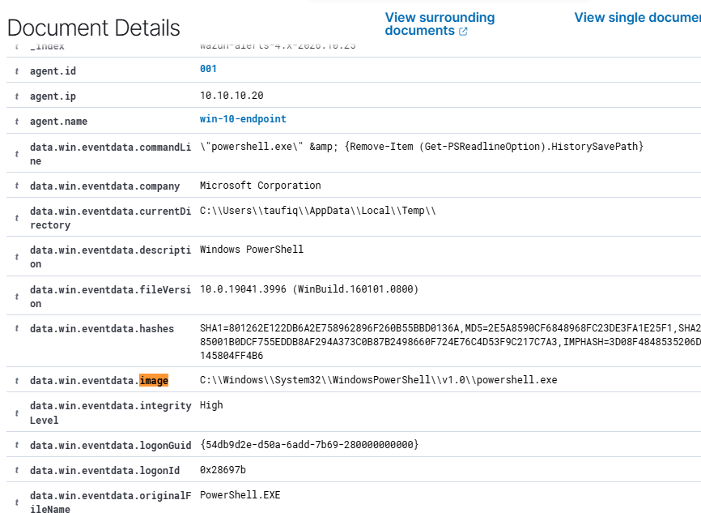
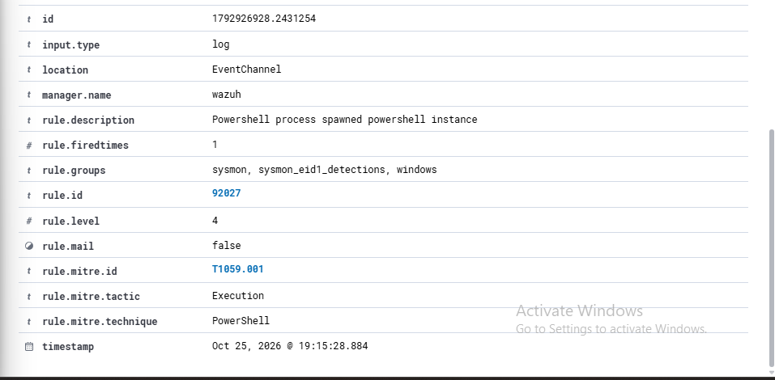
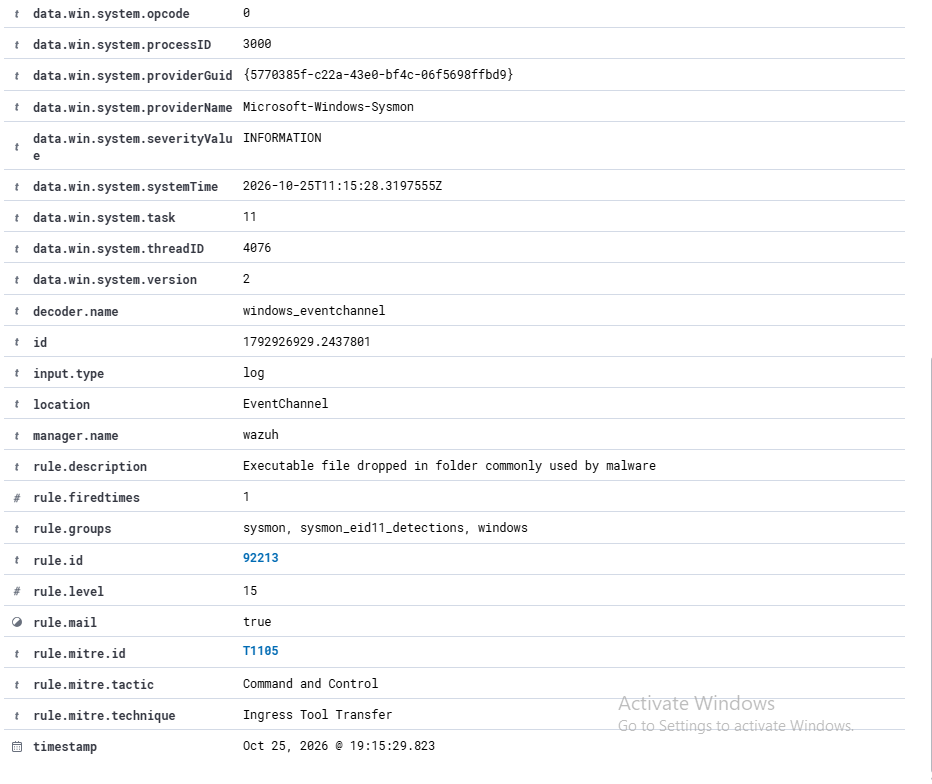
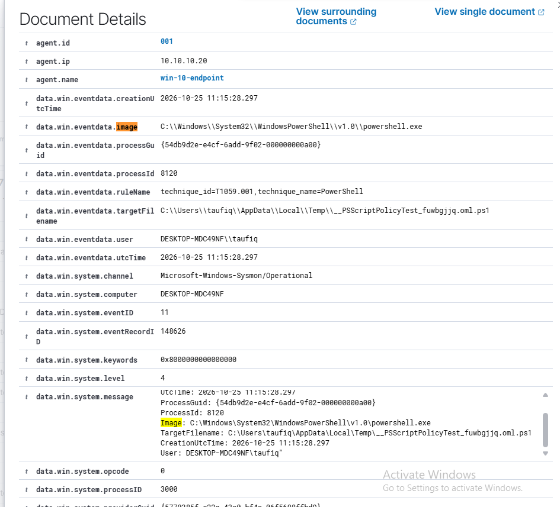

# Detection Validation Report: Atomic Red Team — Indicator Removal (T1070.003)

**Analyst:** Taufiq
**Date:** 2026-10-25
**Environment:** Home SOC Lab (Proxmox, isolated network)
**Classification:** Internal / Portfolio

---

## 1. Objective

Validate whether the deployed SIEM detects a defense-evasion / anti-forensics technique — clearing PowerShell command history — using an ATT&CK-mapped Atomic Red Team test rather than a live offensive tool. The goal was to confirm whether the ruleset recognizes the *specific intent* of the action (evidence destruction), not just generic process activity, and to catch any rules that fire incorrectly in the process.

- **T1070.003 — Indicator Removal: Clear Command History**

---

## 2. Environment / Scope

Same lab topology as Phase 01 (`00-infrastructure/network-diagram.md`).

| Role | Hostname | IP | Notes |
|---|---|---|---|
| SIEM / Manager | wazuh | 10.10.10.10 | Wazuh 4.14, all-in-one |
| Target endpoint | win-10-endpoint | 10.10.10.20 | Windows 10 Pro, Sysmon (Olaf Hartong "balanced" config), Wazuh agent 4.14.8 |

**Tools used:** Atomic Red Team (`Invoke-AtomicTest`), Wazuh 4.14 (manager + indexer + dashboard), Sysmon.

---

## 3. Test — Clear PowerShell Command History (MITRE ATT&CK T1070.003)

### Procedure

Ran the Atomic Red Team test for T1070.003 on `win-10-endpoint` via `Invoke-AtomicTest`, which executes the following command through a nested PowerShell process:

```powershell
"powershell.exe" & {Remove-Item (Get-PSReadlineOption).HistorySavePath}
```

This deletes the user's PSReadLine history file (`ConsoleHost_history.txt`) — the record of every command typed in a PowerShell session — a classic anti-forensics step taken after an attacker has already operated on a host.

### Expected Outcome

A rule should ideally flag the **deletion of the PowerShell history file itself** as a defense-evasion indicator, distinct from ordinary PowerShell usage.

### Evidence

- `win-10-endpoint` (agent 001, 10.10.10.20), timestamp `2026-10-25 19:15:28.884`
- Sysmon Event ID 1 (ProcessCreate): nested `powershell.exe` → `powershell.exe`, `commandLine` matching the Atomic test exactly


*Figure 1: `data.win.eventdata.commandLine` showing `Remove-Item (Get-PSReadlineOption).HistorySavePath`, spawned by `powershell.exe` with `originalFileName: PowerShell.EXE` — confirms this is the Atomic test execution.*


*Figure 2: Rule 92027, "Powershell process spawned powershell instance," level 4, mapped to T1059.001 (Execution: PowerShell) — fired on this event.*

### Result

| Event | Rule ID | Level | MITRE Mapping | Description |
|---|---|---|---|---|
| Nested PowerShell process spawn | 92027 | 4 | T1059.001 | Powershell process spawned powershell instance |

### Analysis

The event was detected, but only incidentally. Rule 92027 matches on the generic **parent/child process relationship** (`powershell.exe` spawning `powershell.exe`), which is simply how `Invoke-AtomicTest`'s PowerShell executor runs every test — it would fire identically for any Atomic test on this host, regardless of what the nested command actually does. Nothing in the ruleset inspects the command line for history-clearing intent (e.g. `Remove-Item` combined with `HistorySavePath`/`ConsoleHost_history`), and no rule alerts on deletion of the history file itself. The technique was *observed* but not *recognized* — a level-4 alert gives no indication that evidence destruction took place.

---

## 4. Secondary Observation — False Positive on Rule 92213

During the same test window, a second, higher-severity rule fired and initially appeared to be a related detection.

### What fired


*Figure 3: Rule 92213, "Executable file dropped in folder commonly used by malware," level **15** (critical), mapped to T1105 (Command and Control: Ingress Tool Transfer) — fired one second after rule 92027, same host, same PowerShell session.*


*Figure 4: The event rule 92213 actually matched — `targetFilename: __PSScriptPolicyTest_fuwbgjjq.oml.ps1`, a `.ps1` script, created by `powershell.exe` in the user's Temp folder.*

### Verification

Cross-checking the two events:

| | Rule 92213 claims | What the event actually shows |
|---|---|---|
| Expected | An **executable** dropped in a malware-associated folder | A **`.ps1` script** — not an executable |
| File | — | `__PSScriptPolicyTest_fuwbgjjq.oml.ps1` — a file Windows/PowerShell creates automatically as part of its own script-execution-policy validation, with no attacker involvement |
| Timing | — | 19:15:29.823, one second after the Atomic test's nested PowerShell process launched at 19:15:28.884 |

Rule 92213 fired in the same window purely because it shares a root cause with the real test (both events come from the same `Invoke-AtomicTest` PowerShell session) — not because it detected anything we did. It is a **false positive**: a level-15/critical alert, mapped to T1105 (payload delivery), triggered by a routine Windows-internal `.ps1` artifact that appears any time certain PowerShell cmdlets run. The rule's matching logic appears to key off file creation in a Temp-like path without verifying the file is actually an executable, which produces a mislabeled, critical-severity alert on benign activity.

---

## 5. Findings / Gaps Identified

**Gap: no detection for the specific technique (T1070.003).** The ruleset has no rule recognizing "PowerShell command history was deleted" as an anti-forensics action. The only alert generated was a generic, low-severity, nested-process-spawn rule that would fire identically for unrelated PowerShell activity — an analyst triaging this alert alone would have no reason to suspect evidence destruction.

**Gap/Bug: rule 92213 is a false positive generator.** It is tagged critical severity (level 15) and mapped to T1105, but its matching logic does not verify that the dropped file is actually an executable. It fires on a benign, automatically-created `.ps1` script, which would generate a high-severity false alarm on normal PowerShell use across the environment — a real tuning problem for any analyst relying on this rule's severity to triage.

---

## 6. Recommendations / Next Steps

1. **Write a custom rule for T1070.003** that matches specifically on deletion of `ConsoleHost_history.txt` (or any file under the PSReadLine history path), correlated with a `Remove-Item`/`del` command line, and assign it a severity reflecting its defense-evasion intent rather than ordinary PowerShell usage.
2. **Tighten rule 92213's match criteria** to check the file extension (or a PE/executable signature) before firing, and/or exclude the known-benign `__PSScriptPolicyTest_*.ps1` pattern, to eliminate this false positive at the rule level.
3. **Continue Atomic Red Team coverage testing** across other ATT&CK techniques to build out this phase, using the same verify-before-attribute approach: confirm the matched event's actual fields align with the technique tested before counting a rule as a true detection.

---
