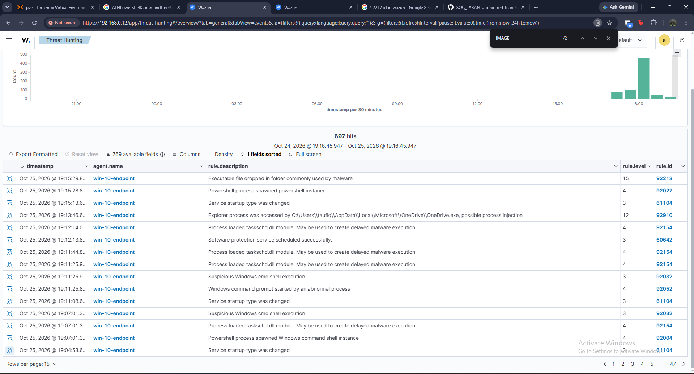
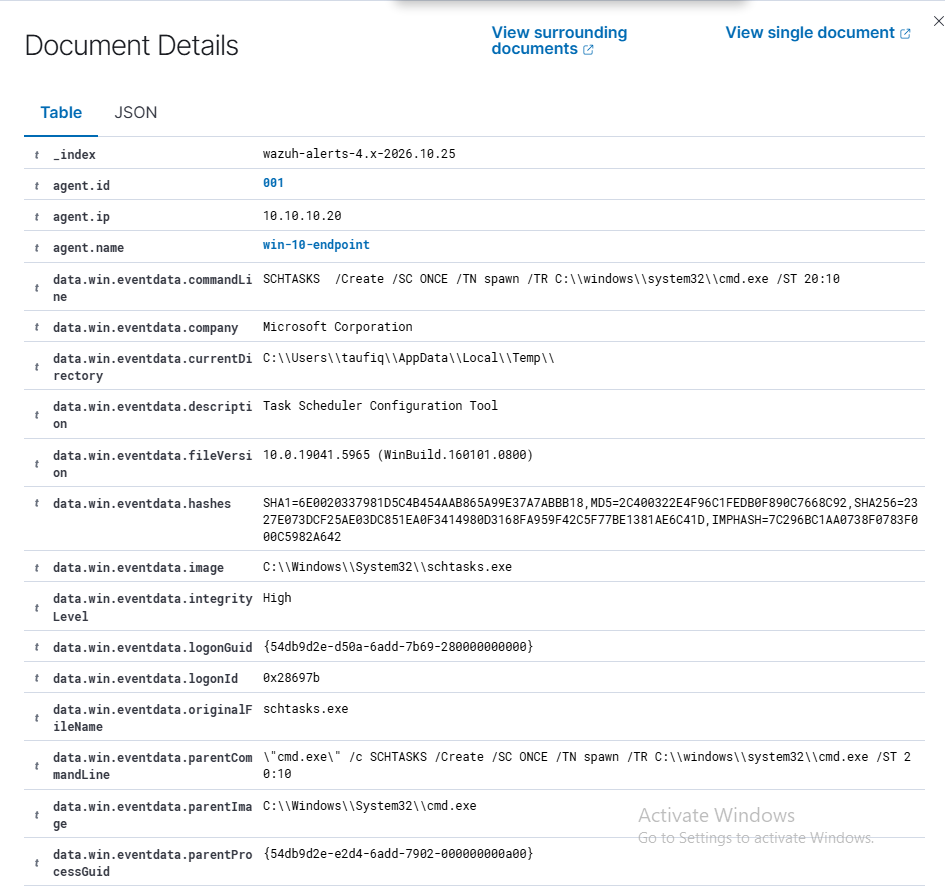
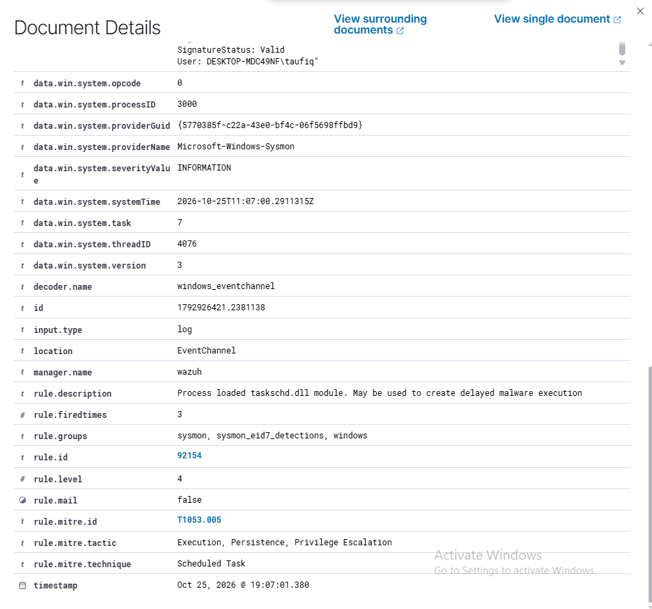
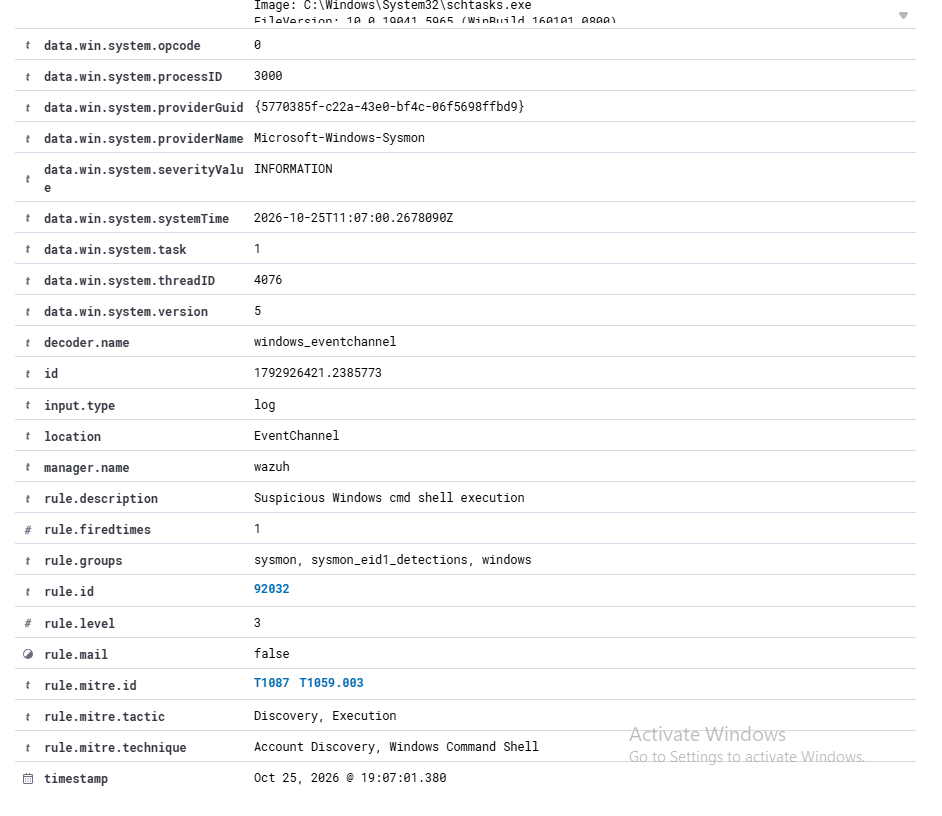

# Detection Validation Report: Atomic Red Team — Persistence & Defense Evasion

**Analyst:** Taufiq
**Date:** 2026-10-25
**Environment:** Home SOC Lab (Proxmox, isolated network)
**Classification:** Internal / Portfolio

---

## 1. Objective

Validate whether the deployed SIEM detects three ATT&CK-mapped persistence and defense-evasion techniques, executed via Atomic Red Team (`Invoke-AtomicTest`) rather than a live offensive tool. The goal was to confirm whether detections reflect the *actual technique* being tested — not just incidental process activity — and to catch any rules that fire incorrectly along the way.

- **T1547.001 — Boot or Logon Autostart Execution: Registry Run Keys / Startup Folder**
- **T1053.005 — Scheduled Task/Job: Scheduled Task**
- **T1070.003 — Indicator Removal: Clear Command History**

---

## 2. Environment / Scope

Same lab topology as Phase 01 (`00-infrastructure/network-diagram.md`).

| Role | Hostname | IP | Notes |
|---|---|---|---|
| SIEM / Manager | wazuh | 10.10.10.10 | Wazuh 4.14, all-in-one |
| Target endpoint | win-10-endpoint | 10.10.10.20 | Windows 10 Pro, Sysmon (Olaf Hartong "balanced" config), Wazuh agent 4.14.8 |

**Tools used:** Atomic Red Team (`Invoke-AtomicTest`), Wazuh 4.14 (manager + indexer + dashboard), Sysmon.


*Figure 1: Alert volume for `win-10-endpoint` across the test window (Oct 24–25, 2026). Each test below was isolated from this view by timestamp and cross-checked field-by-field before being attributed to a specific Atomic test — several rows in this list turned out to be unrelated noise or mismapped detections (see Sections 4 and 6).*

---

## 3. Test 1 — Registry Run Key Persistence (MITRE ATT&CK T1547.001)

### Procedure

Ran Atomic Red Team test **T1547.001-1 "Reg Key Run"** (GUID `e55be3fd-3521-4610-9d1a-e210e42dcf05`) on `win-10-endpoint`:

```cmd
REG ADD "HKCU\SOFTWARE\Microsoft\Windows\CurrentVersion\Run" /V "Atomic Red Team" /t REG_SZ /F /D "C:\Path\AtomicRedTeam.exe"
```

Execution completed successfully (exit code 0), followed by the test's standard cleanup command.

### Expected Outcome

Sysmon's registry-monitoring events (Event ID 13, RegistryEvent: Value Set) should capture a value being written to a well-known autostart Run key, and a Wazuh rule should alert on it as a persistence indicator.

### Evidence

No corresponding alert was found in Wazuh for this test — checked across the full session timeline, including the window immediately preceding the T1053.005 test that ran next. The registry modification itself was confirmed to have occurred independently via Windows Event Viewer on the endpoint, but that confirmation did not come from, and was not cross-referenced against, the Wazuh/Sysmon pipeline.

### Result

| Event | Rule ID | Level | Description |
|---|---|---|---|
| Registry Run key value set | — | — | **No alert generated** |

### Analysis

This is a genuine detection gap, not a pipeline failure — the rest of the session (Tests 2 and 3 below) shows Wazuh actively alerting on other activity from the same endpoint in the same time window, so ingestion was working. Registry Run Key persistence (T1547.001), one of the most common real-world persistence techniques, produced no alert at all. This is a materially more serious finding than the generic/mismatched detections in the other two tests — it isn't miscategorized or imprecise, it simply isn't covered.

---

## 4. Test 2 — Scheduled Task Persistence (MITRE ATT&CK T1053.005)

### Procedure

Ran Atomic Red Team test **T1053.005-2 "Scheduled task Local"** (GUID `42f53695-ad4a-4546-abb6-7d837f644a71`) on `win-10-endpoint`:

```cmd
SCHTASKS /Create /SC ONCE /TN spawn /TR C:\windows\system32\cmd.exe /ST 20:10
```

### Expected Outcome

Scheduled-task creation should be visible either through the process creation of `schtasks.exe` itself, or through the Task Scheduler COM API being invoked (`taskschd.dll` being loaded) — and a rule should map that behavior to T1053.005.

### Evidence

- `win-10-endpoint` (agent 001, 10.10.10.20), event cluster at `2026-10-25 19:07:01`
- Process chain confirmed: `powershell.exe` → `cmd.exe` → `schtasks.exe`, commandLine matching the Atomic test exactly


*Figure 2: `data.win.eventdata.commandLine`: `SCHTASKS /Create /SC ONCE /TN spawn /TR C:\windows\system32\cmd.exe /ST 20:10`, `image: schtasks.exe`, `parentImage: cmd.exe` — confirms this is the Atomic test execution.*


*Figure 3: Rule 92154, "Process loaded taskschd.dll module. May be used to create delayed malware execution," level 4, correctly mapped to **T1053.005**. This fired on `schtasks.exe` loading `taskschd.dll` — the Task Scheduler COM API — which is exactly what scheduled-task creation looks like at the OS level.*


*Figure 4: Rule 92032, "Suspicious Windows cmd shell execution," level 3, mapped to T1087 (Account Discovery) and T1059.003 — fired on the same `cmd.exe` → `schtasks.exe` launch, but its MITRE tag doesn't match what actually happened.*

### Result

| Event | Rule ID | Level | MITRE Mapping | Description |
|---|---|---|---|---|
| `schtasks.exe` loaded `taskschd.dll` | **92154** | 4 | **T1053.005 (correct)** | Process loaded taskschd.dll module. May be used to create delayed malware execution |
| `cmd.exe` spawned `schtasks.exe` | 92032 | 3 | T1087, T1059.003 (mismatched) | Suspicious Windows cmd shell execution |
| `powershell.exe` spawned `cmd.exe` | 92004 | 4 | T1059.003 (generic) | Powershell process spawned Windows command shell instance |

### Analysis

Rule **92154 is the strongest detection validated in this phase so far** — it is both a true positive and correctly mapped to the technique actually tested, unlike the generic process-spawn matches seen elsewhere. Rules 92032 and 92004 also fired on real events from the same test, but neither is a purpose-built detection: 92004 is the same generic nested-process artifact produced by `Invoke-AtomicTest`'s executor wrapper seen in Test 3, and 92032 caught the right process launch but tagged it with an unrelated ATT&CK technique (Account Discovery), which would mislead an analyst using the MITRE tag to triage. 92154 is the one rule here an analyst could actually trust for intent, not just activity.

---

## 5. Test 3 — Clear PowerShell Command History (MITRE ATT&CK T1070.003)

### Procedure

Ran Atomic Red Team test **T1070.003-12 "Clear Powershell History by Deleting History File"** (GUID `da75ae8d-26d6-4483-b0fe-700e4df4f037`) on `win-10-endpoint`, executed through a nested PowerShell process:

```powershell
"powershell.exe" & {Remove-Item (Get-PSReadlineOption).HistorySavePath}
```

This deletes the user's PSReadLine history file (`ConsoleHost_history.txt`) — the record of every command typed in a PowerShell session — a classic anti-forensics step taken after an attacker has already operated on a host.

### Expected Outcome

A rule should ideally flag the **deletion of the PowerShell history file itself** as a defense-evasion indicator, distinct from ordinary PowerShell usage.

### Evidence

- `win-10-endpoint` (agent 001, 10.10.10.20), timestamp `2026-10-25 19:15:28.884`
- Sysmon Event ID 1 (ProcessCreate): nested `powershell.exe` → `powershell.exe`, `commandLine` matching the Atomic test exactly


*Figure 5: `data.win.eventdata.commandLine` showing `Remove-Item (Get-PSReadlineOption).HistorySavePath`, spawned by `powershell.exe` with `originalFileName: PowerShell.EXE` — confirms this is the Atomic test execution.*


*Figure 6: Rule 92027, "Powershell process spawned powershell instance," level 4, mapped to T1059.001 (Execution: PowerShell) — fired on this event.*

### Result

| Event | Rule ID | Level | MITRE Mapping | Description |
|---|---|---|---|---|
| Nested PowerShell process spawn | 92027 | 4 | T1059.001 | Powershell process spawned powershell instance |

### Analysis

The event was detected, but only incidentally. Rule 92027 matches on the generic **parent/child process relationship** (`powershell.exe` spawning `powershell.exe`), which is simply how `Invoke-AtomicTest`'s PowerShell executor runs every test — it fires identically regardless of what the nested command actually does (the same artifact produced rule 92004 in Test 2). Nothing in the ruleset inspects the command line for history-clearing intent (e.g. `Remove-Item` combined with `HistorySavePath`/`ConsoleHost_history`), and no rule alerts on deletion of the history file itself. The technique was *observed* but not *recognized*.

---

## 6. Secondary Observation — False Positive on Rule 92213

During the Test 3 window, a second, higher-severity rule fired and initially appeared to be a related detection.

### What fired


*Figure 7: Rule 92213, "Executable file dropped in folder commonly used by malware," level **15** (critical), mapped to T1105 (Command and Control: Ingress Tool Transfer) — fired one second after rule 92027, same host, same PowerShell session.*


*Figure 8: The event rule 92213 actually matched — `targetFilename: __PSScriptPolicyTest_fuwbgjjq.oml.ps1`, a `.ps1` script, created by `powershell.exe` in the user's Temp folder.*

### Verification

| | Rule 92213 claims | What the event actually shows |
|---|---|---|
| Expected | An **executable** dropped in a malware-associated folder | A **`.ps1` script** — not an executable |
| File | — | `__PSScriptPolicyTest_fuwbgjjq.oml.ps1` — a file Windows/PowerShell creates automatically as part of its own script-execution-policy validation, with no attacker involvement |
| Timing | — | 19:15:29.823, one second after the Atomic test's nested PowerShell process launched at 19:15:28.884 |

Rule 92213 fired in the same window purely because it shares a root cause with the real test (both events come from the same `Invoke-AtomicTest` PowerShell session) — not because it detected anything we did. It is a **false positive**: a level-15/critical alert, mapped to T1105 (payload delivery), triggered by a routine Windows-internal `.ps1` artifact that appears any time certain PowerShell cmdlets run. The rule's matching logic appears to key off file creation in a Temp-like path without verifying the file is actually an executable, which produces a mislabeled, critical-severity alert on benign activity.

---

## 7. Findings / Gaps Identified

**Gap: no detection coverage for Registry Run Key persistence (T1547.001).** No alert was generated at all, despite confirmed execution of the technique. This is the most significant gap identified in this phase — unlike the other two tests, nothing fired, correctly or otherwise.

**Strength confirmed: rule 92154 is a correct, intent-matched detection (T1053.005).** Scheduled-task creation via `schtasks.exe` loading `taskschd.dll` was both detected and accurately mapped to the right ATT&CK technique — the one clean result across all three tests.

**Gap: no detection for the specific technique tested in T1070.003.** The only alert generated was a generic, low-severity, nested-process-spawn rule (92027) that fires identically for unrelated PowerShell activity, giving no indication that evidence destruction took place.

**Gap/Bug: two rules carry mismatched or misleading MITRE mappings.** Rule 92032 (Test 2) tagged a scheduled-task creation as "Account Discovery" (T1087); rule 92213 (Test 3) is a false-positive generator entirely, mapping a benign `.ps1` artifact to T1105 at critical severity. Both would mislead an analyst using the MITRE tag — rather than the raw event — to triage.

---

## 8. Recommendations / Next Steps

1. **Build detection for T1547.001** — alert on `RegistryEvent` writes to known autostart keys (`...CurrentVersion\Run`, `RunOnce`, etc.), which currently has zero coverage.
2. **Write a custom rule for T1070.003** that matches specifically on deletion of `ConsoleHost_history.txt` (or any file under the PSReadLine history path), correlated with a `Remove-Item`/`del` command line, and assign it a severity reflecting its defense-evasion intent rather than ordinary PowerShell usage.
3. **Correct rule 92032's MITRE mapping** so scheduled-task-related `cmd.exe` activity isn't tagged as Account Discovery.
4. **Tighten rule 92213's match criteria** to check the file extension (or a PE/executable signature) before firing, and/or exclude the known-benign `__PSScriptPolicyTest_*.ps1` pattern, to eliminate this false positive at the rule level.
5. **Continue Atomic Red Team coverage testing** across other ATT&CK techniques, using the same verify-before-attribute approach: confirm the matched event's actual fields align with the technique tested before counting a rule as a true detection.

---
