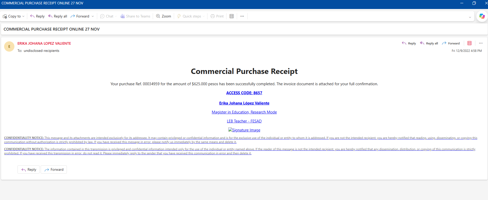
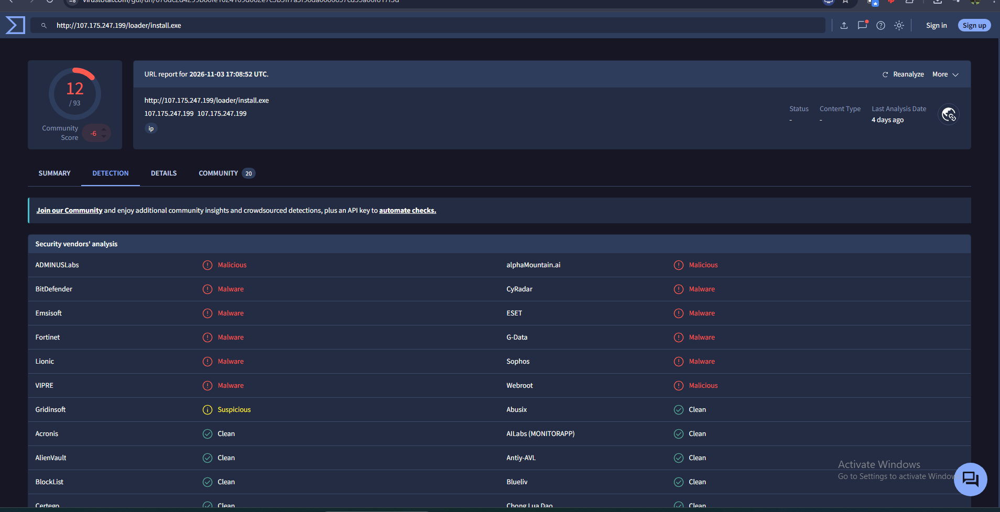
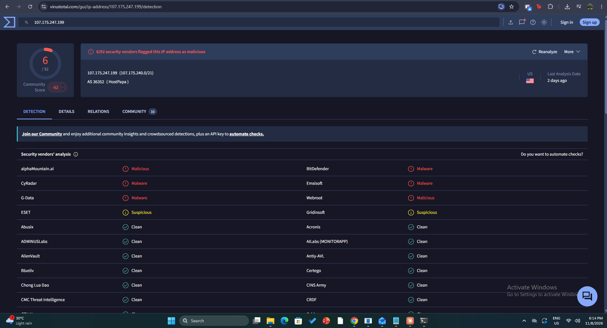
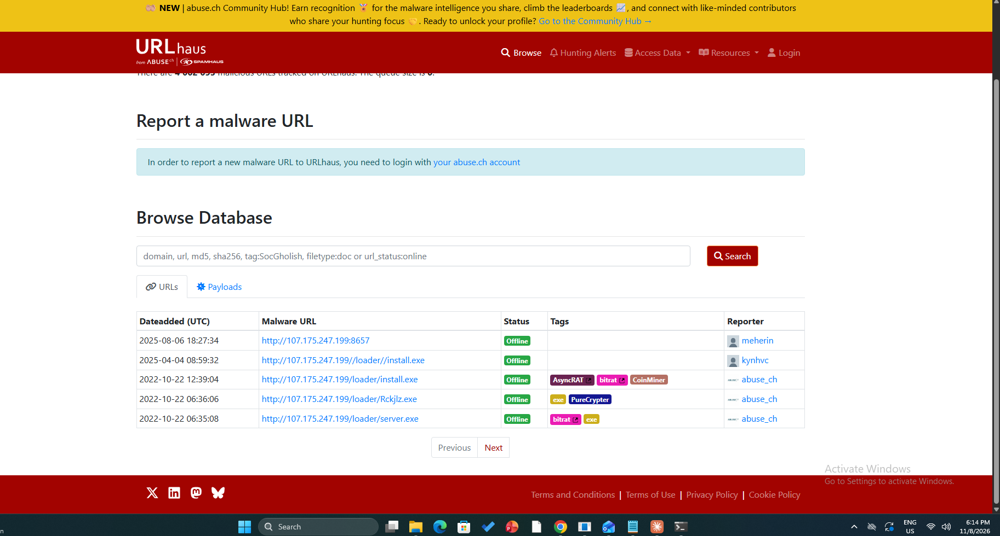
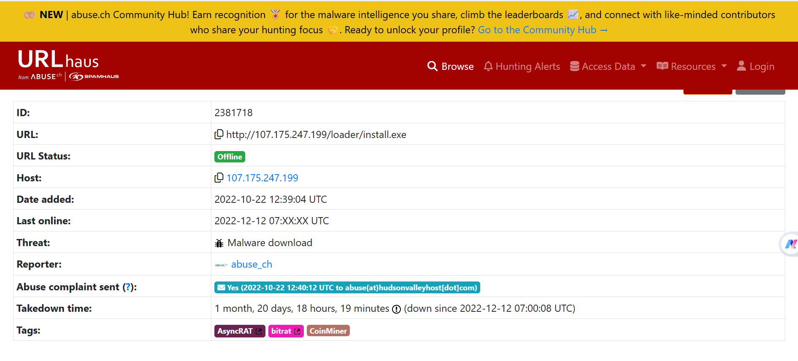
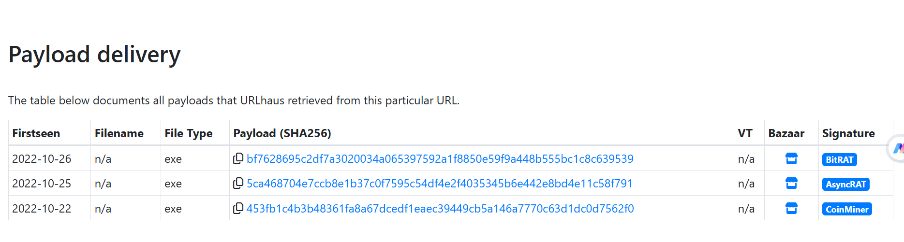
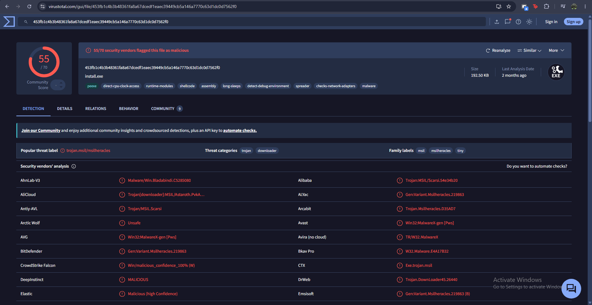

# Phishing Analysis Report: "COMMERCIAL PURCHASE RECEIPT ONLINE 27 NOV"

**Analyst:** Taufiq
**Date:** 2026-11-10
**Source:** CyberDefenders "PhishStrike" lab sample (training exercise, not a live incident)
**Classification:** Internal / Portfolio
**Tools used:** Outlook (rendered view), text editor (raw headers), VirusTotal, URLhaus, AbuseIPDB

---

## 1. Objective

Given a single suspicious email, decide whether it is malicious and why, using only the message itself plus public threat-intelligence lookups: authenticate the sender from the raw headers, trace the delivery path, inspect the body and its link, extract and enrich indicators of compromise (IOCs), and state what can and cannot be concluded. The sample was never executed and the payload was never downloaded.

---

## 2. Scope

| Item | Detail |
|---|---|
| Sample | One `.eml`, opened as text for headers and in Outlook for the rendered view |
| Scenario (from the lab) | A faculty member at an educational institution receives an email claiming a $625,000 purchase with a link to download an invoice |
| Handling | Link hovered, never clicked. The URL and IP were looked up in reputation services only. No file was downloaded or detonated |
| Not covered | Dynamic/sandbox analysis of the payload, DNS records for the sender domain, mail-server logs on the recipient side |

---

## 3. Email Overview

| Field | Value |
|---|---|
| Subject | `COMMERCIAL PURCHASE RECEIPT ONLINE 27 NOV` |
| From | `ERIKA JOHANA LOPEZ VALIENTE <erikajohana.lopez@uptc.edu.co>` |
| Return-Path | `erikajohana.lopez@uptc.edu.co` |
| To | `undisclosed-recipients:;` (real recipient `servicios.informaticos@fsfb.org.co`, per the `for <...>` line in the Received headers) |
| Message-ID | `<CABWu4iua5_uex6=G8pi_OJz1tBLJiNakMK-1=7128orpzxbKxw@mail.gmail.com>` |
| Lure | Purchase receipt, Ref. `00034959`, `$625.000 pesos`, "invoice document is attached", `ACCESS CODE: 8657` |


*Figure 1: The email in Outlook. Several elements are underlined as links: the "ACCESS CODE" line, the signature lines, and the confidentiality notices (see Section 5.2). The signature image fails to load.*

---

## 4. Header Analysis

### 4.1 Sender authentication

The message was checked by two different systems, and they gave different answers:

| Check | Trend Micro gateway (sees Google's IP `209.85.221.65`) | Microsoft (sees Trend Micro's relay IP `18.208.22.104`) |
|---|---|---|
| SPF | `pass` | `softfail` |
| DKIM | `none (no processed signatures)` | `fail (no key for signature)`, `header.d=uptc.edu.co` |
| DMARC | `pass`, `action=no records` | `none`, `action=none` |
| Composite | n/a | `compauth=softpass reason=201` |

**What this means:** the SPF softfail is not evidence of a forged sender. Microsoft evaluated SPF against the IP that connected to it, which is the recipient's own Trend Micro gateway, and that IP is not in the sender domain's SPF record. The check that saw the original sending IP (Google) passed. The `DMARC=none` result means no enforcing policy was applied to this domain (Microsoft reports no policy action). The raw message also carries a `DKIM-Signature` with `d=uptc.edu.co; s=google`, but Microsoft reported no key for it. The headers alone do not show why, and I did not query the DNS record for that selector, so the cause is **not determined**.

### 4.2 Routing (Received chain, read bottom-up)

| Hop | Server | Role |
|---|---|---|
| 1 (origin) | `mail-wr1-f65.google.com` (`209.85.221.65`) | Google mail infrastructure. First hop to touch the message |
| 2 | `inpre01.tmes.trendmicro.com` → `inpost.tmes.trendmicro.com` (`18.208.22.104`) | Trend Micro Email Security, the recipient organization's gateway |
| 3 | `*.protection.outlook.com` / Exchange Online | Microsoft 365 for the recipient |

The routing contains nothing unusual: the message left Google and passed through the recipient's own filtering stack. **The Received chain alone does not indicate phishing.**

### 4.3 Sender alignment

`From` and `Return-Path` are the same address on `uptc.edu.co`, and the DKIM signature's signing domain (`d=uptc.edu.co`) matches the `From` domain. There is no domain mismatch and no spoofing indicator. The domain is real and the message went out through Google infrastructure carrying that domain's identity. This pattern is consistent with a **legitimate account being abused** (for example a compromised mailbox), not a spoofed domain. The headers cannot confirm compromise; it is an assessment, not a finding.

### 4.4 Delivery verdict

Microsoft stamped the message `SCL:1` with `SFV:NSPM` (non-spam verdict) and delivered it to the inbox (`dest:I`). It therefore passed both the Trend Micro gateway and Microsoft's filters with a not-spam result.

### 4.5 Timestamps are inconsistent (unresolved)

| Source | Stamp as written | Converted to UTC | Weekday correct? |
|---|---|---|---|
| `Date:` (set by the sender's client) | `Thu, 9 Dec 2022 09:58:26 +0100` | 2022-12-09 08:58:26 | No. 9 Dec 2022 was a **Friday** |
| `X-Received` (Google) | `Mon, 27 Dec 2022 06:58:38 -0800` | 2022-12-27 14:58:38 | No. 27 Dec 2022 was a **Tuesday** |
| Epoch inside the `X-Received` ID (`1701097118`) | n/a | **2023-11-27 14:58:38 (Monday)** | Matches the "Mon" label and the "27 NOV" in the subject |
| Trend Micro / Microsoft `Received` lines | `Thu, 9 Dec 2022 14:58:42 +0000` and similar | 2022-12-09 14:58:4x | No. 9 Dec 2022 was a Friday |

Outlook displays the message as received **Fri 12/9/2022** (Figure 1), which agrees with the real weekday for 9 Dec 2022, so Outlook is using the calendar date, not the weekday text in the header.

The time of day (14:58 UTC) is consistent across Google, Trend Micro, Microsoft, and the epoch, but the calendar dates disagree (9 Dec 2022, 27 Dec 2022, 27 Nov 2023). URLhaus records the payload URL as online until **2022-12-12** (Section 6.3), which fits a December 2022 send date; a November 2023 send date would put the email about eleven months after that URL was taken down. I could not tell which set of dates is authentic. Possible explanations include a sample modified when the lab was built, a clock misconfiguration, or deliberate tampering, and nothing in the headers distinguishes them. **No conclusion in this report depends on the header dates.**

---

## 5. Body and Link Analysis

### 5.1 The link

The plain-text part reads:

```
VIEW INVOICE DOCUMENT HERE
<hxxp://107[.]175[.]247[.]199/loader/install[.]exe>
ACCESS CODE: 8657
```

The text promises an invoice document. The destination is an **executable** (`install.exe`) under a `/loader/` path, hosted on a **bare IP address over plain HTTP**, not a document and not a named domain.

### 5.2 Malformed HTML anchor

In the HTML part the anchor tag is never closed: `<a href="hxxp://107[.]175[.]247[.]199/loader/install[.]exe"` runs straight into the next `<p>` tag with no `>` and no link text. In Outlook (Figure 1) this makes the "ACCESS CODE" line, the signature block and the confidentiality notices render as hyperlinks, and hovering them showed the `install.exe` URL. The sender's template is sloppy, but the result still works as a lure because almost anywhere a recipient clicks leads to the same download.

### 5.3 Claim versus reality

The body states "the invoice document is attached for your full confirmation." The MIME structure is `multipart/alternative` with only a `text/plain` part and a `text/html` part. **There is no attachment.** The only thing delivered is the link.

### 5.4 Other indicators

- **BCC mass delivery.** `To: undisclosed-recipients:;` means the real recipients were in BCC. The copy analysed went to a shared IT services mailbox (`servicios.informaticos@fsfb.org.co`). A genuine purchase receipt would be addressed to the named buyer.
- **Generic, financial lure.** A large payment amount, an order reference and an "access code", with no recipient name or order details.
- **Brand dressing.** The signature image is hot-linked from a Wikimedia Commons URL for the university's logo. It is a benign host and is **not** an IOC. It does not load in Outlook (Figure 1).

---

## 6. IOC Enrichment

### 6.1 URL (VirusTotal)


*Figure 2: VirusTotal URL report for the payload URL (report dated 2026-11-03): 12 of 93 vendors flag it malicious. Flagging vendors: ADMINUSLabs, alphaMountain.ai, BitDefender, CyRadar, Emsisoft, ESET, Fortinet, G-Data, Lionic, Sophos, VIPRE, Webroot. Gridinsoft: suspicious.*

### 6.2 Host IP `107.175.247.199`

| Source | Result |
|---|---|
| VirusTotal (IP) | 6 of 92 vendors malicious (alphaMountain.ai, BitDefender, CyRadar, Emsisoft, G-Data, Webroot). ESET and Gridinsoft: suspicious. AS36352 (labelled HostPapa), US, `107.175.240.0/21` |
| AbuseIPDB | Confidence score **0%**. ISP Hudson Valley Host, usage type Data Center/Web Hosting/Transit, AS36352, hostname `caststem.com`, domain `hudsonvalleyhost.com`, Buffalo NY, US. (Total report count not captured) |
| URLhaus | Five malware URLs listed for this host, all currently offline (Figure 4) |


*Figure 3: VirusTotal IP report. 6 of 92 vendors malicious; AS36352.*

**Reputation sources disagree.** AbuseIPDB shows 0% while VirusTotal and URLhaus both flag the host. AbuseIPDB is built around reports of scanning, brute-forcing and spam, so a host that only serves malware files can score 0% there. A clean result from one source did not outweigh the others. The ISP name also differs between sources (Hudson Valley Host vs HostPapa), so the ASN (AS36352) is the stable identifier.

### 6.3 URLhaus history of the host


*Figure 4: URLhaus database entries for `107.175.247.199`.*

| Added (UTC) | URL | Tags |
|---|---|---|
| 2022-10-22 06:35 | `/loader/server.exe` | bitrat |
| 2022-10-22 06:36 | `/loader/Rckjlz.exe` | PureCrypter |
| 2022-10-22 12:39 | `/loader/install.exe` | AsyncRAT, bitrat, CoinMiner |
| 2025-04-04 | `/loader//install.exe` | none |
| 2025-08-06 | `:8657` (bare port, no path) | none |

The `/loader/install.exe` entry (ID 2381718) is the same path as the one in the email:


*Figure 5: URLhaus detail page. Added 2022-10-22 12:39:04 UTC, last online 2022-12-12, takedown time 1 month 20 days after an abuse complaint was sent to the hosting provider on 2022-10-22. Threat type: malware download.*


*Figure 6: Three different payloads were retrieved from this one URL between 22 and 26 October 2022.*

| First seen | SHA256 | URLhaus signature |
|---|---|---|
| 2022-10-22 | `453fb1c4b3b48361fa8a67dcedf1eaec39449cb5a146a7770c63d1dc0d7562f0` | CoinMiner |
| 2022-10-25 | `5ca468704e7ccb8e1b37c0f7595c54df4e2f4035345b6e442e8bd4e11c58f791` | AsyncRAT |
| 2022-10-26 | `bf7628695c2df7a3020034a065397592a1f8850e59f9a448b555bc1c8c639539` | BitRAT |

The same URL served three different payloads in five days. Blocking on a file hash alone would not have covered the path.

### 6.4 Payload hash lookup (VirusTotal)


*Figure 7: VirusTotal file report for `453fb1c4…`: 55 of 70 vendors malicious, file name `install.exe`, 192.50 KB.*

| Field | Value |
|---|---|
| Detection | 55 / 70 |
| Popular threat label | `trojan.msil/msilheracles` |
| Threat categories | trojan, downloader |
| Family labels | msil, msilheracles, tiny |
| VirusTotal tags | detect-debug-environment, long-sleeps, checks-network-adapters, shellcode, spreader |

The tags are VirusTotal's automatic labels, not behaviour I observed. **The family label differs between sources:** URLhaus tagged this hash as CoinMiner, while the VirusTotal consensus is a .NET trojan/downloader, and individual vendors use several different names. Without detonating the sample I cannot say which is right, so the report records both. The other two hashes were transcribed from the URLhaus page and **were not looked up in VirusTotal** (see Section 7).

---

## 7. Findings / Gaps

**Verdict: malicious. Phishing email delivering a link to a malware loader.** Confidence is high, resting on the reputation of the link and host, the executable-versus-invoice mismatch and the false attachment claim. It does not rest on the email's appearance or the header dates.

| # | Finding |
|---|---|
| 1 | The sender domain is genuine and the routing is normal. This is not spoofing. The pattern is consistent with an abused account, but compromise is an assessment and is not confirmed |
| 2 | Authentication results differ by checkpoint. The SPF softfail comes from the recipient's own gateway being the connecting IP. DMARC was not enforced for the sender domain |
| 3 | **The message passed both Trend Micro and Microsoft filtering** (SCL 1, not spam) and was delivered to the inbox |
| 4 | The link text promises an invoice but points to an executable on a bare IP over HTTP, and the email's claimed attachment does not exist |
| 5 | The host has a documented history of serving malware: the same path served three different payloads (miner and two RATs per URLhaus) in October 2022 |
| 6 | Header timestamps are inconsistent and **unresolved** (Section 4.5) |

**Gaps and limitations**

- **No dynamic analysis.** The payload was not downloaded or detonated. The URL and host are offline now (URLhaus), so current behaviour cannot be verified.
- **VirusTotal hash lookups were done for one of the three payload hashes.** The other two are unverified beyond URLhaus, and were transcribed from a screenshot, so check them against the page before using them for blocking.
- **Family attribution is unresolved** (URLhaus CoinMiner vs VirusTotal trojan/downloader).
- A URLScan result was not captured as evidence for this write-up.
- **The DKIM failure reason was not determined** (the selector's DNS record was not checked).
- **An unexplained coincidence:** the lure's `ACCESS CODE: 8657` is the same number as the port in a 2025 URLhaus entry for this same IP (`:8657`). Nothing in the headers explains it and I did not investigate further. It is recorded as an observation only and is not an IOC.
- The sender's name and address come from a training sample. The account owner is more likely a victim than an attacker.

---

## 8. MITRE ATT&CK Mapping

| Technique | ID | Basis |
|---|---|---|
| Phishing: Spearphishing Link | T1566.002 | Email delivers a malicious link (mass-sent via BCC) |
| User Execution: Malicious File | T1204.002 | The lure depends on the recipient downloading and running `install.exe` (not observed, inferred from the design of the lure) |
| Compromise Accounts: Email Accounts | T1586.002 | Assessed from legitimate sending infrastructure and aligned identity. **Not confirmed** |

Payload-specific techniques (RAT/miner behaviour) are not mapped because the payload was not analysed.

---

## 9. Recommendations / Next Steps

1. **Block** the URL and the IP `107.175.247.199` at the proxy, DNS and firewall.
2. **Search mail logs** for the subject, the Message-ID, the sender address and the URL to find every recipient, and purge the message from mailboxes.
3. **Hunt endpoints** for `install.exe` downloaded from a bare IP, and for the three SHA256 hashes. Add a mail-filter rule for messages whose links point to a bare IP or an executable path.
4. **Report** the abused account to the sender's organization (`uptc.edu.co`) and the hosting provider's abuse contact, and note that the sender organization could publish an enforcing DMARC policy.
5. **Close the lookup gaps:** run the other two hashes in VirusTotal, capture the URLScan result, and check the DKIM selector's DNS record.
6. **Lab follow-up:** use this sample as a test case for detection of a download from a bare IP in the Wazuh/Sysmon pipeline (Phase 6).

---

## Appendix: IOC Summary

IOCs are defanged. `Action` shows what to do with each indicator.

| Type | Indicator | Action |
|---|---|---|
| URL | `hxxp://107[.]175[.]247[.]199/loader/install[.]exe` | Block |
| IPv4 | `107[.]175[.]247[.]199` (AS36352, rDNS `caststem[.]com`) | Block |
| File name | `install.exe` | Hunt |
| SHA256 | `453fb1c4b3b48361fa8a67dcedf1eaec39449cb5a146a7770c63d1dc0d7562f0` | Block / hunt (VirusTotal 55/70) |
| SHA256 | `5ca468704e7ccb8e1b37c0f7595c54df4e2f4035345b6e442e8bd4e11c58f791` | Block / hunt (not looked up in VirusTotal) |
| SHA256 | `bf7628695c2df7a3020034a065397592a1f8850e59f9a448b555bc1c8c639539` | Block / hunt (not looked up in VirusTotal) |
| Email | `erikajohana.lopez@uptc[.]edu[.]co` | Report to domain owner; do not block the domain |
| Subject | `COMMERCIAL PURCHASE RECEIPT ONLINE 27 NOV` | Mail-log hunt |
| Message-ID | `<CABWu4iua5_uex6=G8pi_OJz1tBLJiNakMK-1=7128orpzxbKxw@mail.gmail.com>` | Mail-log hunt |
| Lure strings | `00034959`, `$625.000 pesos`, `ACCESS CODE: 8657` | Content hunt |
| Context only | `209[.]85[.]221[.]65` (Google), `18[.]208[.]22[.]104` (Trend Micro), `uptc[.]edu[.]co`, Wikimedia logo URL | **Do not block** (legitimate infrastructure) |
